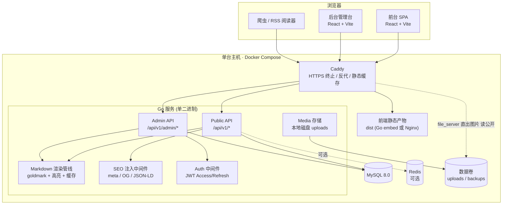
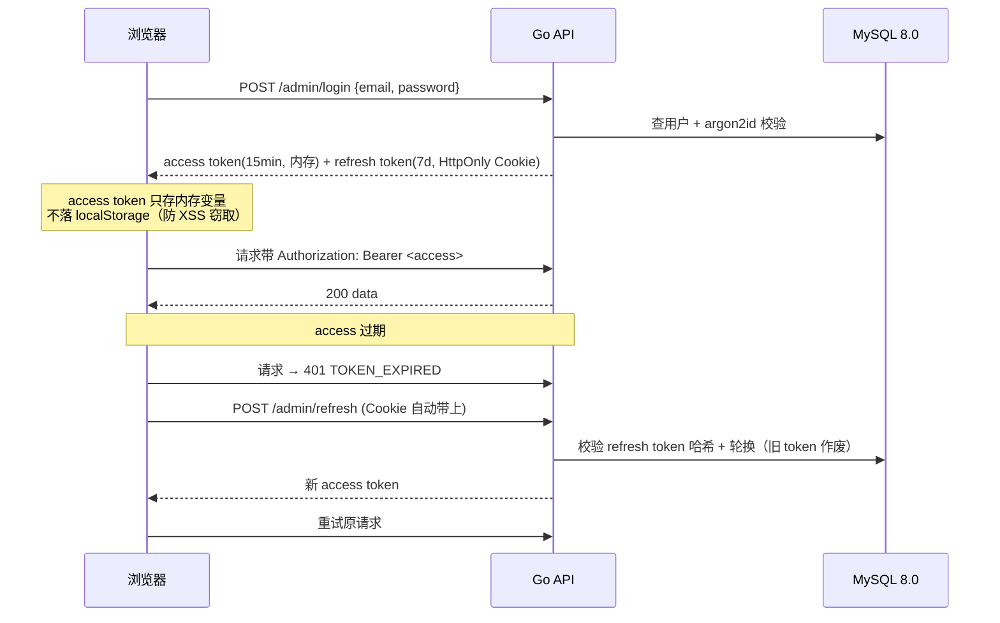
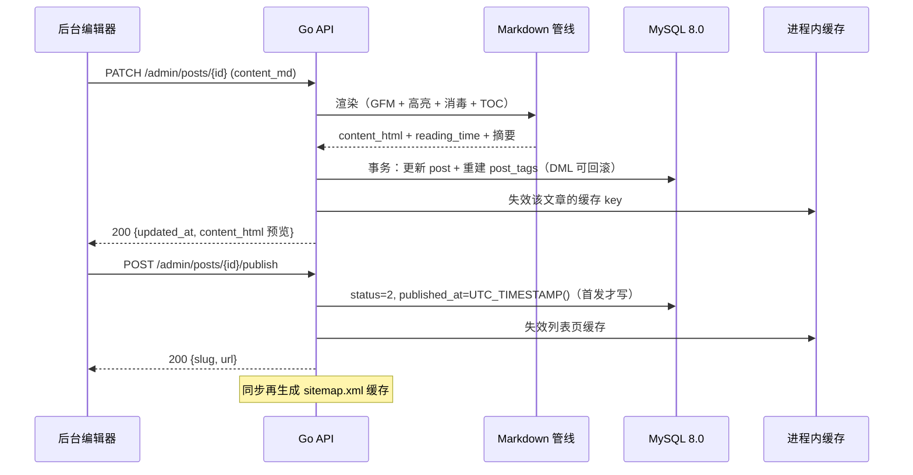

7 # 个人博客系统 · 技术方案设计文档

> 前端 React + 后端 Go。本文档只做设计与规划，**不包含实现代码**。
> 版本：**v1.12** ｜ 状态：**设计已定稿，M1/M2 已完成并端到端验证；M3 评论与搜索已完成（评论公开列表支持分页 + 滚动加载）；M2 补充（六）–（十五）均已落地（普通用户默认即作者、前台/后台/工作台彻底断链、用户菜单与前台一致、管理员独立登录页、评论昵称跟随用户、工作台顶栏用户菜单下拉等）**
>
> **配套文档**（职责不同，别混淆）：
>
> | 文档 | 回答的问题 |
> | --- | --- |
> | 本文 `personal-blog-tech-plan.md` | **是什么、为什么这么选**（设计与选型） |
> | [`development-plan.md`](./development-plan.md) | **接下来做什么、验收标准是什么**（开发规划） |
> | [`implementation-status.md`](./implementation-status.md) | **现在能跑什么、怎么跑、改过什么**（落地总览，唯一入口） |
> | [`devlog/Mx-*.md`](./devlog/) | **每阶段实际做了什么、踩了什么坑**（阶段记录） |
>
> **v1.4 变更（2026-09-28，M1 落地回写）**：**代码高亮由 Shiki 改为 chroma（class-based 输出）** —— v1.3 的 §7.1 存在内部矛盾：Shiki 是 TypeScript 库，而渲染发生在 Go 侧，两者无法共存。改为 chroma 后，明暗双主题退化为两份 CSS，切主题零 JS。细节见 §7.1 与 [devlog/M1-content-loop.md](./devlog/M1-content-loop.md)。另：新增 `posts.toc_json` 列（迁移 `00013`），§4 与 §6.5 同步更新。
>
> **v1.5 变更（2026-09-29，M2/M3 落地回写）** —— 两处实现偏离原选型，如实记录：
> ① **图片处理不再强制 WebP / 不再依赖 bimg(libvips)**。本机 Windows 无法编译 libvips 的 C 依赖，按 M2 已知风险降级为 Go 原生 `golang.org/x/image` 处理：落盘文件名由 `<ULID>.webp` 改为 `<ULID>.<原扩展名>`（jpeg/png/gif/webp 原样保留，GIF 直出不重编码），仅对超 1600px 宽做等比缩放。功能不减，代价是失去 WebP 的体积极致压缩。§5.5 文件名行与下方「上传流程」已回写为准。
> ② **后台编辑器未采用 ByteMD**，改用「原生 textarea + `marked` 实时预览」。ByteMD 体积大且构建耦合度高，文本域 + 预览切换足够支撑 Markdown 写作，且首屏零负担；后台路由已分包隔离。若日后要双栏实时体验可换 Milkdown。
> ③ 搜索**跳过 `LIKE` 阶段，直接上 ngram FULLTEXT**（索引与 `ngram_token_size=2` 已就绪，中文/英文都准）。属能力增强。详见 [devlog/M2-admin-backend.md](./devlog/M2-admin-backend.md) 与 [devlog/M3-comments-search.md](./devlog/M3-comments-search.md)。
> ④ **v1.6 变更（2026-09-29，注册与权限模型）**：项目从「单管理员」扩展为「公开注册 + 权限分层」。新增 `POST /api/v1/admin/register`（公开注册，注册即签发会话自动登录）；`users` 表新增 `can_publish` 列；新增 `RequirePublish` 中间件，文章 CRUD / 媒体管理 / 评论管理 / 用户管理均改走该权限，上传仍走 `RequireUpload`；新增用户管理接口与页面，管理员可开启/关闭某用户的发帖与上传权限。普通注册用户默认 `can_upload=1`（可上传）、`can_publish=0`（不可发帖），发帖权限由管理员开启。详见 [devlog/M2-admin-backend.md](./devlog/M2-admin-backend.md) 的「M2 补充」小节。
>
> **v1.8 变更（2026-09-29，数据按用户隔离）** —— v1.7 只把**界面**拆成「我的博客」(`/studio`) 与「纯管理后台」(`/admin`)，数据仍是全站共享：任何作者都能看改删别人的文章与图片，博主身份还写死在前端常量里。本轮补上**行级归属**：
> ① **文章与媒体按 `author_id` 隔离**。查询统一写成 `WHERE (? = 0 OR author_id = ?)`（0 = 不过滤，历史上仅站点管理员在 `/admin` 管理场景下使用；在「我的博客」工作台 `/studio` 中始终按当前用户过滤），写操作先取行再校验归属，非本人 → 403「只能操作自己创建的内容」。判断收敛在 `service.Actor`，**不新增权限维度**。
> ② **`media.author_id`**（迁移 `00024`）：上传时写入操作者；`author_id=0` 是迁移前的历史遗留数据，**只有管理员能管**（普通用户 id 从 1 起，永远不等于 0，天然被挡在外面）。不回填历史数据——回填等于猜归属，猜错更糟。
> ③ **个人资料数据化**：`users.bio` / `avatar_url` / `github`（迁移 `00025`）。`PATCH /admin/me` 由本人改自己（**user id 只从 token 取**，不接受路径参数）；匿名 `GET /site/profile` 返回站长（id 最小的管理员）公开资料，**刻意不含邮箱**。前端 `config/site.ts` 退化为兜底默认值。§4.1 ER、§5.2/§5.3 接口表同步。
> ④ **评论管理收归 `RequireAdmin`**：评论挂在文章上、留言者是匿名访客，属全站数据，不属于「我的博客」。
>
> **v1.9 变更（2026-09-29，用户成为前台一等公民）** —— v1.8 做完了**数据归属**，但前台仍是「一个没有作者概念的内容站」：文章不署名、点不到人、匿名访客没有登录入口、登录后顶栏也不显示自己是谁。本轮补上**公开侧的用户维度**：
> ① **文章署名**：`PostListItem` / `Post` 新增 `author{public_id, display_name, avatar_url}`。列表页由 `attachAuthors` **批量一次查齐再回填**（不是逐篇查，避免 N+1）；对外只暴露 public_id 与昵称/头像，**不含邮箱与权限位**。
> ② **用户博客主页** `GET /users/{publicID}` + `GET /users/{publicID}/posts`（匿名可读）：个人资料头 + 其已发布文章列表 + 分页。前端路由 `/blog/:publicID`，分页走 URL search params。新开两个**公开只读查询**（`GetPublicUserByID` / `GetPublicUserByPublicID` / `ListPublicUsersByIDs`），与后台 `AdminUser`**刻意分开定义**，避免哪天后台字段被误塞进公开响应。
> ③ **顶栏身份区**：匿名显示「登录 / 注册」；已登录显示`头像 + 昵称`（链到 `/studio/profile`）与「退出」。这是「我的博客」的入口锚点，此前登录后无从知道自己以谁的身份在操作。
> ④ 后台用户管理每行加「博客」直达链接，管理员可从后台跳到任意用户的公开主页核对。§4.1 ER、§5.2 接口表、§6.1 路由表同步。
>
> **v1.9 补记（同日，实测后）**：① 顶栏身份区升级为**用户菜单**（头像+昵称展开：我的主页 / 个人资料 / 我的博客(仅 can_publish) / 后台(仅 is_admin) / 退出）——普通用户的「用户模块」入口由此补全；② **`/studio/profile` 修正为仅需登录**（§6.1 原表误标 `can_publish`；个人资料属本人，编辑功能才需要发帖权限，与 `PATCH /admin/me` 的后端边界对齐）；③ 注册邮箱校验收紧为**必须带「.后缀」的正则**（`12@123` 这类地址此前能注册成功并自动生成怪昵称）。
>
> **v1.10 变更（2026-09-29，前台与后台彻底断链，用户明确要求）** —— **撤销 v1.6～v1.9 期间「前台给后台留入口」的全部设计**：导航「我的博客」「后台」链接、用户菜单里的同名条目、文章详情页「编辑」直达、登录后按权限自动分流进 `/admin`/`/studio`——全部移除。**前台是纯内容站，工作台与后台只能由用户直接输 URL 访问**（口令式入口，类似 WordPress 的 `wp-admin`）：
>
> **v1.11 变更（2026-09-30，普通用户默认即作者，上传改由管理员授予）** —— 用户明确要求「普通用户个人主页也应能编辑/发布文章，且上传权限由后台管理员判断」，故**反转 v1.6 的注册默认值**：
> - 普通注册用户默认 `can_publish=1`（**注册即为作者**，可在「我的博客」写/发文章）、`can_upload=0`（**上传权限改由管理员授予**的特权，默认关闭）、`is_admin=0`（永不为管理员）。
> - **本人查看自己的 `/blog/{publicID}` 主页时**，资料头下方出现「写新文章 / 管理我的博客」入口——这是「普通用户个人主页也能编辑/发布」的落点；它**只对自己可见、只指向对自己内容的操作**，不属于把后台入口暴露到公开导航（v1.10 的断链取舍仍然成立：导航与用户菜单里依旧没有 `/studio`、`/admin` 链接）。
> - 媒体库前端按 `can_upload` 显隐上传按钮：无权限时显示「无上传权限」并提示联系管理员；后端 `RequireUpload` 仍兜底。
> - **权限变动的生效时机**：JWT 是 stateless 的，管理员在后台改了某用户的 `can_publish/can_upload` 后，需该用户**重新登录（或 refresh）**才会拿到新令牌生效——属已知取舍，与 v1.6 起一致。
> ① **为什么**：用户要求「不管是管理员还是普通用户都不能从前台跳转后台，后台需要单独访问」。此前三轮迭代一直在往顶栏加权限入口，方向反了——前台读者（含作者本人闲逛时）根本不需要看见管理入口，入口越多越像"管理系统"，不像博客。
> ② **保留的东西**：`/studio`、`/admin` 路由与守卫原样（直接访问不受影响）；`ProtectedRoute` 把未登录者踢到 `/login?redirect=来源`，登录后**回到来源页**（这是"被踢出去再回去"，不是前台跳转）；登录无来源时一律落首页，不再按权限分流。用户菜单保留**我的主页 / 个人资料 / 退出**（公开侧身份，不属于后台）。
> ③ §6.1 路由守卫与身份区说明、§2.3 公开侧用户维度行同步。v1.9 补记①中「用户菜单含我的博客/后台」自本版起作废。
> ④ **追记（同日实测）**：工作台导航同样断链——`StudioLayout` 移除「后台」「评论」入口（评论管理在 `/admin` 内部导航本就有）。**`/admin` 从此没有任何站内指向，唯一入口是 URL 直访**；`AdminLayout` 的「我的博客/前台」返回链接保留（方向是离开后台，不违反本原则）。
>
> **v1.12 变更（2026-09-30，首页去 Hero + 评论滚动分页 + 工作台去「前台」）** —— 三处与实现的再对齐：
> - **首页移除 Hero**：`PostListPage` 不再渲染「你好，我是 XX」自我介绍区，文章列表直接置顶；右侧栏（个人卡片 / 标签云 / 最近写作）保留。
> - **关于页标题按视角**：`/about` 仍是站长视角内容，但标题改为——站长本人看「关于我」、其他用户 / 匿名看「关于作者」。
> - **评论公开列表分页 + 滚动加载**：`GET /api/v1/posts/{slug}/comments` 现支持 `page/page_size` 并返回带 `total` 的分页结构；新增 `GET /api/v1/posts/{slug}/comments/count` 仅返回公开评论总数（评论图标角标用，不拉内容）。前端 `CommentSection` 改为默认折叠（只显示「💬 评论（数量）」图标按钮），展开后用 `IntersectionObserver` 触底加载下一页。
> - **工作台导航精简**：`StudioLayout` 顶栏去掉「前台」跳转，上栏背景改为与前台一致的毛玻璃（`bg-bg/85 backdrop-blur`）；导航改为 **首页 / 文章（按权限） / 个人资料**，移除「媒体库」入口（`/studio/media` 路由仍保留，用户可直接输 URL 访问）。
> - **后台导航精简**：`AdminLayout` 顶栏仅保留 **用户 / 评论**，移除「我的博客」「前台」跳转按钮；无权限提示页也移除「返回博客首页」按钮。
> - **用户只能编辑自己的博客**：`service.Actor.AuthorFilter()` 改为始终返回当前用户 ID，站点管理员在「我的博客」`/studio` 也只能看到/编辑自己的文章与媒体；用户管理页移除每行「博客」按钮，管理员不再能从后台直跳用户主页。
> - **用户菜单「我的主页」改为回首页**：`UserMenu` 中「我的主页」由 `/blog/{public_id}` 改为 `/`，与个人公开博客页解耦。
> - **管理员独立登录页**：新增 `/admin/login` 作为管理员专属登录入口；未登录访问 `/admin/*` 重定向到 `/admin/login`；登录后前端校验 `is_admin`，非管理员即使密码正确也拒绝并登出；普通用户仍使用 `/login`。
> - **评论昵称跟随用户**：已登录用户提交评论时，`author_name` 自动取自 `display_name`（邮箱前缀兜底），前端隐藏昵称输入框，不可手动修改；匿名用户仍可自定义昵称。
> - **工作台顶栏改为用户菜单下拉**：`StudioLayout` 顶栏导航精简为 **首页 / 文章（按权限）**；新增 `StudioUserMenu` 组件（与前台 `UserMenu` 样式一致），将「个人资料」「退出登录」收进右上角头像下拉；保留「首页」作为返回前台出口。
> ④ v1.11 追记中「导航只剩 文章/媒体库/个人资料/前台」自本版起作废（前台按钮已移除、媒体库入口已移除）；后台「我的博客/前台」返回链接同步移除。

> **v1.4 补记（同日，端到端验证后）** —— 三处设计与实现对齐：
> ① **审计字段由数据库兜底**：`created_at` 一律 `DEFAULT CURRENT_TIMESTAMP(3)`，`updated_at` 另加 `ON UPDATE`（迁移 `00014`–`00018`）。原设计没写这层，实测 MySQL 严格模式下任何 INSERT 少传一个就报 Error 1364，靠调用点自觉必然再犯。
> ② **删除 `tags.post_count`**（迁移 `00019`）：原设计 §4.9 建议"冗余计数在 service 事务内维护"，实现后否定了它 —— 计数由 `ListTagsWithCount` 的 JOIN 实时算即可，本项目规模下缓存无意义，而维护成本高且易漏。§4.9 已改写。
> ③ **h1 是文章主标题**，不进 TOC、不进摘要；正文从 h2 起。原设计未区分，实测导致列表摘要开头重复一遍标题。
>
> **v1.3 变更（2026-09-28）**：建立上述四份文档体系；§9 的阶段划分细化 —— 原 M3（上线与 SEO）拆为 **M4（SEO）** 与 **M5（部署，用户明确暂缓）**，使 SEO 不被"不部署"阻塞。细节以 `development-plan.md` 为准。
>
> **v1.2 变更**：① 评论**不做审核**，提交即公开（§7.5）；② **暗色模式必须支持**，新增 §6.5 并归入 M1；③ 内容全新写作，**不做迁移工具**；④ 部署定为 **Docker Compose**，新增附录 D。
>
> **v1.1 变更**：数据库由 PostgreSQL 切换为 **MySQL 8.0**（本地无 PG 环境）。
> 涉及 §1.2、§4、§7.3、§8、附录 C 的类型、索引与全文检索调整；**新增 §1.2.2「MySQL 方言带来的实现约束」，落地前必读**。

---

## 0. 文档说明与前提假设

### 0.1 目标

从零搭建一个可长期维护、能上线、能持续写文章的个人博客系统。核心诉求排序：

1. **写文章要顺手**（Markdown，草稿/发布，标签/归档）
2. **访问要快**（秒开、SEO 友好、RSS）
3. **运维要轻**（一个人维护，尽量少的服务依赖，一条命令部署）
4. **架构要留有余地**（未来加评论、搜索、图床、统计时不推翻重来）

### 0.2 前提假设（如与实际不符，请指出，我据此调整）

| 项 | 假设 | 备注 |
| --- | --- | --- |
| 规模 | 文章量 < 1000 篇，日 PV < 1 万 | 单机单实例足够，无需微服务/K8s |
| 内容形态 | 以图文技术文章为主，Markdown 编写 | 不涉及富媒体、多人协作、付费内容 |
| 部署环境 | 一台 Linux 云主机（**已确认 4 核 4G**）+ Docker | 域名 + HTTPS；容量核算见附录 C |
| 数据库 | **MySQL 8.0**（本地无 PostgreSQL 环境） | 方言约束见 §1.2.2 |
| 内容来源 | **全新写作**，无存量文章需要迁移 | 不做导入 / 导出工具 |
| 评论 | **暂不做审核**，发布即公开 | 靠限流 + 蜜罐防垃圾；保留 `status` 字段与管理员删除能力，将来 spam 多了再开审核 |
| 暗色模式 | **必须支持**（亮 / 暗 / 跟随系统 三态） | 涉及主题体系与 Shiki 双主题，M1 一并做完，见 §6.5 |
| 部署方式 | **Docker Compose** | 见附录 D |
| 维护者 | 1 人（作者本人兼管理员） | 权限模型可以极简：单管理员 |
| 交互形态 | 前台是内容站，后台是管理台 | 前台偏静态、后台偏应用，两者诉求不同 |

### 0.3 非目标（本期明确不做）

- 多用户注册 / 多作者 / 角色权限体系
- 分布式部署、水平扩容、消息队列
- 原生 App、小程序
- 复杂的可视化埋点看板（仅需基础访问统计）

---

## 1. 技术选型

### 1.1 前端

| 维度 | 选型 | 理由 |
| --- | --- | --- |
| 框架 | **React 19 + TypeScript** | 生态最大，招聘/社区资源多；TS 在中后台管理台收益极高 |
| 构建 | **Vite** | 冷启动快，配置简单；SSR 需要时再迁 Next.js |
| 路由 | **React Router v7（data mode）** | 前后台共用一套路由；data router 提供 loader/action，减少手写请求逻辑 |
| 服务端状态 | **TanStack Query v5** | 缓存、失效、分页、重试、乐观更新开箱即用，省掉大量 useEffect |
| 客户端状态 | **Zustand** | 只装 UI 状态（主题、编辑器草稿、侧栏开合），不滥用 |
| 样式 | **Tailwind CSS v4 + shadcn/ui** | 开发速度最快；shadcn 组件代码在本地，可任意改，无黑盒 |
| Markdown 渲染 | **react-markdown + remark-gfm + rehype-*** | 支持 GFM（表格、删除线、任务列表），插件链清晰 |
| 代码高亮 | **Shiki** | 构建期/服务端高亮，产物是静态 HTML，客户端零 JS 开销，主题与 VS Code 一致 |
| 后台编辑器 | **ByteMD**（或 Milkdown）；v1.5 实际用 **原生 textarea + `marked` 预览** | 双栏实时预览体验最佳；M2 因体积/构建耦合降级为 textarea + marked，够用 |
| 测试 | **Vitest + Testing Library**，关键链路 **Playwright** | 单元测组件与工具函数，E2E 只覆盖「登录 → 写文 → 发布 → 前台可见」 |

**关于是否用 Next.js**：
前台博客的 SEO 是真实需求，Next.js（SSR/SSG）是最省事的答案。但本方案选择 **Vite SPA + Go 侧轻量 SSR 注入**（见 §7.4），理由是：

- 前后台统一管理在一个前端工程里，不必为一个后台管理台引入 SSR 心智负担；
- Node 服务端运行时是额外的一层，对「一个人运维」是负担；
- 文章的 SEO 需求集中在「首屏 HTML 里要有正文和 meta」，用 Go 侧对爬虫做 meta/正文注入即可满足，成本远低于整套 SSR。

> 若后续确认需要完整的 SSR/ISR/图片优化，再平滑迁移到 Next.js，API 层无需改动。

### 1.2 后端

| 维度 | 选型 | 理由 |
| --- | --- | --- |
| 语言 | **Go 1.24+**（用当前最新稳定版） | 单二进制部署、内存占用低、并发模型适合 IO 密集的内容站 |
| HTTP 框架 | **net/http + chi/v5** | chi 完全兼容 `http.Handler`，无私有生态绑定，中间件生态足够；比 Gin 更"标准库友好" |
| 数据库 | **MySQL 8.0**（已定） | 本地已有环境、运维熟悉；ngram parser 让中文全文检索开箱即用 |
| 驱动 | **go-sql-driver/mysql** | 事实标准驱动；连接串需带 `parseTime=true&loc=UTC&charset=utf8mb4` |
| 数据访问 | **sqlc**（代码生成，`engine: mysql`）+ **goose**（迁移） | 写 SQL、生成类型安全 Go 代码，远离 ORM 的隐式行为；迁移可版本化 |
| 配置 | **envconfig / cleanenv + .env** | 结构体即配置，零魔法；够用即可，不引 viper 的重依赖 |
| 日志 | **标准库 log/slog** | 结构化日志，无需第三方；配 JSON handler 输出到 stdout 交给容器收集 |
| 认证 | **golang-jwt/jwt/v5** + **argon2id**（密码哈希） | 管理员登录用 Access(15min)/Refresh(7d) 双 token；argon2id 优于 bcrypt |
| 文件存储 | **本地磁盘**（`MEDIA_DIR`），单一实现 | 明确不接对象存储，不预抽象 S3 接口（避免过度设计）。落盘逻辑收敛在 `pkg/media` 一个包；读写权限策略见 §5.5 |
| 缓存 | 进程内 **LRU/TTL 缓存**；可选 Redis | 单机场景下进程内缓存最省事；预留 Redis 接口 |
| 测试 | **testing + testify + httptest + Testcontainers** | 集成测试起真实 MySQL 容器，避免方言差异导致线上翻车 |

**MySQL 8.0 与 PostgreSQL 的能力对照**（记录取舍，便于日后回溯）：

| | MySQL 8.0 | PostgreSQL 16/17 |
| --- | --- | --- |
| 本地环境 | **已有 / 熟悉** | 需额外搭建 |
| 中文全文检索 | **ngram parser 开箱即用** | 默认不支持，需 zhparser / pgroonga |
| DDL 事务性 | 不支持（隐式提交） | 支持，迁移可整体回滚 |
| `RETURNING` | 不支持 | 支持 |
| 部分索引 / 表达式索引 | 不支持 | 支持 |
| 扩展生态 | 无插件体系 | pg_trgm / pgvector 等 |
| 4C4G 下的性能 | 差异无法体现（见附录 C） | 同左 |
| 结论 | **选用** | 备选 |

### 1.2.1 为什么这次选 MySQL

决定性因素只有一条：**本地没有 PostgreSQL 环境，MySQL 更熟**。对一个一人维护、目标是"尽快上线写文章"的项目，**运维熟悉度的权重高于数据库本身的特性差异**。这不是妥协 —— 附录 C 已核算过，4C4G 下两者性能差异根本无法体现，选型不应为此纠结。

次要收益：**中文全文检索开箱即用**。MySQL 8.0 的 ngram parser 让 `FULLTEXT` 索引直接支持中文，而 PG 默认对中文基本无效（要装 zhparser 或 pgroonga）。对一个中文技术博客，这条很实在。

**为此放弃的能力，以及补偿方案**：

| 放弃的能力 | 补偿方案 |
| --- | --- |
| DDL 事务性（迁移失败会留半截 schema） | 每个迁移文件只写一条 DDL；goose 用 `-- +goose NO TRANSACTION`；`down` 必须手写并实测 |
| `RETURNING` | 用 `sql.Result.LastInsertId()`（sqlc 的 `:execlastid`），或多查一次 |
| 部分索引 | 改建成 `(status, published_at DESC)` 复合索引；数据量小时差别可忽略 |
| 扩展生态（pgvector 等） | 需要时引独立服务（Meilisearch / 向量库），不依赖数据库插件 |
| `timestamptz` / `citext` | `DATETIME(3)` 全链路存 UTC，Go 侧负责时区转换；邮箱大小写不敏感由 `utf8mb4_0900_ai_ci` 排序规则天然提供 |

### 1.2.2 MySQL 方言带来的实现约束（落地前必读）

切到 MySQL 后**真正需要改写法**的地方，写进规范避免踩坑：

1. **占位符是 `?` 不是 `$1`**；sqlc 配置 `engine: mysql`、`sql_package: database/sql`。
2. **迁移不能被事务包裹**：MySQL 的 DDL 会隐式提交。每个 goose 迁移文件头部加 `-- +goose NO TRANSACTION`，并**一个文件只放一条 DDL**，保证失败时状态可判定、`down` 能正确回滚。
3. **取回自增 ID**：用 `sql.Result.LastInsertId()`（sqlc 对应 `:execlastid`），不要写 `RETURNING`。
4. **全文检索的两个坑**：
   - `ngram_token_size` 默认 2（按 2 字切分），**只能在启动时设置**，运行中改不了。
   - `NATURAL LANGUAGE MODE` 有 **50% 阈值**：词出现在超过一半的行里会被直接忽略。文章少（< 200 篇）时这个坑极其明显 —— **统一用 `IN BOOLEAN MODE`**。
5. **字符集**：全库 `utf8mb4` + `utf8mb4_0900_ai_ci`（8.0 默认）。**不要**用 `utf8`（是 3 字节的假 UTF-8，存不了 emoji），也不要退回 `utf8mb4_general_ci`。
6. **连接串**：`user:pass@tcp(host:3306)/blog?parseTime=true&loc=UTC&charset=utf8mb4`。`parseTime=true` 不加会导致时间字段扫描报错；同时显式设 `maxOpenConns` / `maxIdleConns` / `connMaxLifetime`。
7. **`DATETIME` vs `TIMESTAMP`**：统一用 **`DATETIME(3)` 存 UTC**，由 Go 侧转换。不用 `TIMESTAMP`（2038 年问题 + 依赖会话时区，行为隐晦）。
8. **SQL 模式**：保持 `ONLY_FULL_GROUP_BY` 开启（8.0 默认），不要依赖 MySQL 的宽松分组行为，避免将来迁移时暴雷。
9. **审计字段必须让数据库兜底**：`created_at DATETIME(3) NOT NULL DEFAULT CURRENT_TIMESTAMP(3)`，`updated_at` 额外加 `ON UPDATE CURRENT_TIMESTAMP(3)`。
   **这是实测踩出来的，不是可选优化** —— 只写 `DATETIME(3) NOT NULL` 而不给默认值，MySQL 严格模式下任何一条 INSERT 少传一个字段就报 `Error 1364: doesn't have a default value`。
   靠"每个调用点记得传"必然漏，且失败点分散在几十条 SQL 里。`ON UPDATE` 还能省掉每条 UPDATE 手写 `updated_at = ?`（漏写是这类字段最常见的 bug）。
10. **已执行的迁移不可改写**：哪怕库里还没数据、只有本地一个环境，也不要回头改 `00001` 的 `CREATE TABLE`。
    一旦发现第二个环境，两边的 `goose_version` 就对不上，且这类问题排查起来极费时间。schema 要变就追加新的 ALTER 迁移。
11. **冗余计数不做**（原设计曾建议 `tags.post_count` 由 service 事务维护，实现后否定）：
    标签计数直接由 `ListTagsWithCount` 用 `JOIN + COUNT` 实时算，且能天然满足"只统计已发布文章"。
    本项目的规模（<1000 篇）下，这个 JOIN 的代价可以忽略；反过来，维护冗余列要覆盖发布/转草稿/删除/改标签所有路径，漏一处就不一致 ——
    而它最危险的地方是**看起来是对的**：列在、类型对、名字合理，将来谁直接读它会拿到 0 而不起疑。已由迁移 `00019` 删除该列。

### 1.3 基础设施

- **容器化**：Docker 多阶段构建，Go 镜像基于 `gcr.io/distroless/static`（~10MB）
- **部署方式**：**Docker Compose**（caddy + app + mysql 三个服务），详见**附录 D**
- **本地数据库**：Docker Compose 起 `mysql:8.0`，数据卷持久化，`make dev-db` 一键拉起
- **反向代理**：Caddy（自动 HTTPS，配置 5 行）或 Nginx。个人站首选 **Caddy**
- **CI/CD**：GitHub Actions（或 CNB Pipeline）—— push 到 main → 测试 → 构建镜像 → 推 GHCR → SSH 拉取重启
- **备份**：每日 `mysqldump` + `uploads` 打包，**异地存放**（对象存储 / 另一台机器 / 网盘均可）。
  ⚠️ 这与"图片存本地"是两回事：备份**绝不能放在同一块盘上**，否则盘坏了数据全丢

---

## 2. 总体架构

### 2.1 架构图



### 2.2 分层与职责（后端）

```
cmd/server          # 入口：装配依赖、优雅退出
internal/
  config            # 配置加载与校验（启动即失败，不做运行时兜底）
  domain            # 领域实体与错误定义（无外部依赖的纯结构）
  repository        # sqlc 生成的持久化层 + 手写复杂查询
  service           # 业务逻辑（文章、标签、评论、上传、认证）
  transport/http    # Handler、路由、中间件、DTO 转换、参数校验
  pkg/markdown      # Markdown → HTML 渲染管线（goldmark + chroma + bluemonday + DOM 后处理）
  pkg/slug          # slug 生成（中文保留、长度上限、冲突加序号）
  pkg/media         # 图片落盘：校验 / 转码 / 重命名 / 配额（仅本地磁盘实现）
  pkg/auth          # JWT（HS256）/ argon2id 助手
  pkg/apierr        # 统一错误体 {error:{code,message}}
```

**依赖方向严格单向**：`transport → service → repository → DB`。
`service` 不感知 HTTP，`repository` 不感知业务规则。这样后续加 CLI 工具（重建索引、孤儿图片清理）不需要拖着 HTTP 层。

### 2.3 关键设计决策

| 决策 | 选择 | 权衡 |
| --- | --- | --- |
| 文章存储 | **数据库存 Markdown 原文**，渲染结果可缓存 | 不存渲染后 HTML，避免换高亮主题/渲染器时全量重刷 |
| 渲染时机 | 写请求（保存/发布）时渲染并落库 `content_html`，读时直出 | 读 QPS 远高于写；读路径零渲染开销。缓存失效由写操作驱动 |
| 时间存储 | `DATETIME(3)` 统一存 **UTC**，Go 侧转换 | 不用 `TIMESTAMP`：避开 2038 问题与会话时区依赖 |
| 前台形态 | SPA + Go 侧爬虫注入 | 见 §7.4 |
| 部署形态 | Go 单二进制 embed 前端 dist | 一个容器搞定，无 Nginx 静态服务与 API 的跨域/路径割裂 |
| ID 类型 | 内部 `BIGINT UNSIGNED` 自增，对外暴露 **slug** 与 **ULID** | 不暴露自增 ID，防遍历；slug 利于 SEO |
| 图片存储 | **本地磁盘单一实现**，不预抽象对象存储 | 明确不上云；落盘逻辑收敛在 `pkg/media`，将来迁移改动面有限 |
| 图片权限 | **读公开、写受限** | 前台引用图片不需要鉴权；上传/删除必须管理员身份，见 §5.5 |
| 账号与权限 | **公开注册 + 三级权限分层**：`can_upload` 控制上传、`can_publish` 控制发帖与管理**自己的**博客（「我的博客」工作台 `/studio`）、`is_admin` 控制进入**纯管理后台**（`/admin`，用户/权限管理）。普通注册用户 `can_upload=0, can_publish=1, is_admin=0`；**上传权限由管理员开启**（默认关闭），发帖权限注册即拥有；管理后台仅 `is_admin=1` 可进 | 个人博客起步为单管理员，但保留多用户扩展能力。中间件 `RequireUpload`/`RequirePublish`/`RequireAdmin` 区分三级权限；「个人博客编辑界面」与「后台管理」是两套独立界面，普通作者进得了工作台、进不了后台 |
| 数据归属 | **行级隔离**：文章与媒体按 `author_id` 过滤与校验，判断统一收敛在 `service.Actor`（`AuthorFilter()` 传 0 表示管理员不过滤、`CanTouch()` 判定可否操作）。查询写成 `WHERE (? = 0 OR author_id = ?)` 以便 sqlc 静态分析，不在 Go 里拼 SQL | 三级权限只解决了"能不能进这个界面"，没解决"进了以后能看到谁的数据"。少了这层，任何作者都能改删别人的草稿；`author_id=0` 的历史遗留数据只有管理员能管，避免猜归属 |
| 公开侧的用户维度 | **用户是前台一等公民**：文章列表/详情带 `author`，任意用户有 `/blog/{publicID}` 主页（匿名可读），顶栏按登录态显示「登录/注册」或「用户菜单（我的主页/个人资料/退出）」；**前台导航与用户菜单不出现任何进入工作台/后台的入口**（v1.10），但**本人查看自己的 `/blog` 主页时**显示「写新文章 / 管理我的博客」入口（仅对自己可见，是内容操作而非后台入口） | 后台有用户 ≠ 前台有用户。缺了这层，"多用户"只在管理界面成立，读者看不到是谁写的、点不进作者主页。入口断链是 v1.10 的明确取舍：公开导航不暴露管理入口；而作者对自己内容的编辑权在 v1.11 回归到其个人主页 |
| 公开数据面 | **公开查询与后台查询分开定义**（`GetPublicUserByID` / `GetPublicUserByPublicID` / `ListPublicUsersByIDs` vs `AdminUser`） | 复用后台模型最容易漏字段（邮箱、权限位被带出去）。两套 SQL 各自显式列出字段，公开面天然不含私密列；补作者信息走 `attachAuthors` 批量回填，不做逐篇查询 |

---

## 3. 目录结构（Monorepo）

```
blog/
├── go.mod
├── Makefile                        # 统一入口：make dev / test / build / migrate / css
├── sqlc.yaml                       # engine: mysql, sql_package: database/sql
├── docker-compose.yml              # 本地 mysql 8.0（M5 暂缓，尚未创建）
├── Dockerfile                      # 多阶段构建前端 + 后端（M5 暂缓，尚未创建）
├── .github/workflows/ci.yml        # CI（M5 暂缓，尚未创建）
│
├── cmd/
│   ├── server/main.go             # 入口：读配置 → 建依赖 → 起服务 → 优雅退出
│   ├── migrate/main.go            # goose 迁移
│   ├── seed/main.go               # 示例文章导入（-dry-run）
│   ├── gencss/main.go             # 生成 chroma 双主题 CSS
│   └── boot/main.go               # 启动自检
│
├── internal/
│   ├── config/
│   ├── domain/                     # Post, Tag, Comment, User, Media + 领域错误
│   ├── repository/
│   │   ├── migrations/             # goose SQL 迁移（每文件一条 DDL）
│   │   ├── queries/                # sqlc 用的 .sql（占位符 ?）
│   │   └── *.go                    # sqlc 生成 + 手写扩展
│   ├── service/
│   ├── transport/http/
│   │   ├── router.go
│   │   ├── middleware/             # auth, logging
│   │   ├── post_handler.go / auth_handler.go / comment_handler.go
│   │   └── media_handler.go / site_handler.go / admin_post_handler.go
│   └── pkg/{markdown,slug,media,auth,apierr}/   # media 已实装；无 cache/validator
│
├── data/uploads/                   # 运行时图片产物，.gitignore 忽略，容器里挂数据卷
│
├── web/                            # 前端工程
│   ├── index.html
│   ├── vite.config.ts
│   ├── tsconfig.json
│   ├── src/
│   │   ├── main.tsx / router.tsx
│   │   ├── app/                    # providers：QueryClient, Theme, Auth
│   │   ├── features/               # 按领域切分（feature-first）
│   │   │   ├── posts/             # api / adminApi / hooks / components / pages
│   │   │   ├── media/             # 媒体库
│   │   │   ├── auth/              # store / pages（Profile, UsersAdmin）
│   │   │   ├── comments/          # api / hooks / components / pages
│   │   │   ├── users/             # 用户博客主页
│   │   │   └── site/              # 站长公开资料
│   │   ├── components/            # 手写 UI（无 shadcn 抽象层）：Avatar / UserMenu / StudioUserMenu / ThemeToggle / ProtectedRoute / AdminProtectedRoute / TagCloud / ArchiveMini / SearchBox / ProfileCard
│   │   ├── layouts/               # RootLayout / AdminLayout / StudioLayout
│   │   ├── lib/                   # coreFetch(api) / queryClient / format
│   │   ├── config/site.ts         # 博主资料兜底默认值
│   │   └── styles/                # index.css / chroma.css / prose.css
│   └── e2e/                        # Playwright（规划中，尚未落地）
│
└── docs/                           # 四份文档体系
    ├── personal-blog-tech-plan.md  # 技术方案（是什么/为什么）
    ├── development-plan.md         # 开发规划（做什么/验收）
    ├── implementation-status.md    # 落地总览（唯一入口）
    └── devlog/                    # 各阶段记录 Mx-*.md
```

**前端目录策略**：采用 **feature-first**（`features/posts/{api,components,pages,hooks}`），而不是 `components/ pages/ services/` 平铺。文章量增长后，跨目录跳转的成本会变得非常明显。

**⚠️ sqlc 的覆盖陷阱（M0 实操已踩）**：`sqlc generate` 会往 `out` 目录写 **`db.go`、`models.go` 和 `*.sql.go`**。手写文件如果叫这些名字会被**静默覆盖**（实测：手写的 `db.go` 被 sqlc 生成内容整个替换，导致 `repository.Open` 消失）。所以持久化层里手写的连接池代码放在 `pool.go`，不要碰这三个文件名。

---

## 4. 数据模型

### 4.1 ER 图

```mermaid
erDiagram
    users ||--o{ posts : "author"
    users ||--o{ refresh_tokens : "has"
    posts ||--o{ post_tags : "tagged"
    tags  ||--o{ post_tags : "tags"
    posts ||--o{ comments : "has"
    posts ||--o{ media : "attached"
    posts ||--o{ post_views : "tracked"

    users {
        bigint_unsigned id PK "AUTO_INCREMENT"
        varchar_191 email UK "utf8mb4_0900_ai_ci 天然不区分大小写"
        varchar_255 password_hash "argon2id"
        varchar_64 display_name
        varchar_512 bio "一句话简介，前台博主卡片用"
        varchar_512 avatar_url "头像地址，空则用首字母占位"
        varchar_255 github "GitHub 主页链接"
        tinyint_1 can_upload
        tinyint_1 can_publish
        tinyint_1 is_admin "站点管理员，可进纯管理后台"
        datetime_3 created_at "UTC"
    }
    posts {
        bigint_unsigned id PK
        varchar_26 public_id UK "ULID，对外标识"
        varchar_200 slug UK "URL 友好"
        varchar_255 title
        varchar_500 summary "列表摘要，可空则自动截取"
        mediumtext content_md "Markdown 原文"
        mediumtext content_html "渲染结果，内联高亮样式体积大"
        varchar_512 cover_url
        tinyint status "1草稿 2已发布 3归档"
        tinyint_1 comment_enabled
        int_unsigned reading_time_min "渲染时计算"
        datetime_3 published_at "草稿为 NULL"
        datetime_3 created_at "UTC"
        datetime_3 updated_at "UTC"
        bigint_unsigned author_id FK
    }
    tags {
        bigint_unsigned id PK
        varchar_100 slug UK
        varchar_100 name
    }
    %% 注：原设计的 post_count 冗余列已删除（迁移 00019），
    %% 计数由 JOIN + COUNT 实时统计，且只算已发布文章。见 §1.2.2 第 11 条
    post_tags {
        bigint_unsigned post_id PK
        bigint_unsigned tag_id PK
    }
    comments {
        bigint_unsigned id PK
        bigint_unsigned post_id FK
        varchar_64 author_name
        varchar_191 author_email "不对外展示"
        text content
        tinyint status "1公开 2已隐藏"
        varchar_64 ip_hash "隐私合规，只存哈希"
        datetime_3 created_at "UTC"
    }
    media {
        bigint_unsigned id PK
        varchar_512 url
        varchar_255 filename
        bigint_unsigned size_bytes
        varchar_100 mime_type
        int_unsigned width "图片宽高，占位防 CLS"
        int_unsigned height
        bigint_unsigned author_id "0=迁移前历史遗留，仅管理员可管"
        datetime_3 created_at "UTC"
    }
    post_views {
        bigint_unsigned post_id PK
        date view_date PK
        int_unsigned count
    }
    refresh_tokens {
        bigint_unsigned id PK
        bigint_unsigned user_id FK
        varchar_64 token_hash UK
        datetime_3 expires_at "UTC"
        datetime_3 revoked_at "UTC，可空"
    }
```



**两个类型选择的说明**：

- `content_md` / `content_html` 用 **`MEDIUMTEXT`** 而非 `TEXT`：`TEXT` 上限只有 64KB，而内联高亮样式的长文 HTML 很容易超过（附录 C 估算平均 30KB，长文可达数百 KB）。
- `email` 用 `VARCHAR(191)`：这是 InnoDB `utf8mb4` 下能建唯一索引的长度上限（`191 × 4 = 764` 字节 < 767）。同理，`slug` 等需要索引的字符串字段也要控制长度。

### 4.2 关键索引

```sql
-- 列表查询主路径：状态 + 发布时间倒序（MySQL 无部分索引，建成复合索引）
CREATE INDEX idx_posts_published ON posts (status, published_at DESC);
-- 标签归档
CREATE INDEX idx_post_tags_tag ON post_tags (tag_id, post_id);
-- 评论按文章 + 状态 + 时间
CREATE INDEX idx_comments_post ON comments (post_id, status, created_at);
-- 全文检索：ngram parser，中文开箱可用
CREATE FULLTEXT INDEX ft_posts_search ON posts (title, content_md) WITH PARSER ngram;
```

**全文索引的三个注意点**：

1. `ngram_token_size` 默认 2（按 2 字切分），**只能在 MySQL 启动时设置**；改完必须重启并**重建索引**（`DROP` 再 `CREATE`）才生效。
2. 查询统一用 `MATCH(title, content_md) AGAINST(? IN BOOLEAN MODE)` —— `NATURAL LANGUAGE MODE` 的 50% 阈值在数据少时会让常见词直接失效。
3. ngram 对**英文短词**（如 "go"、"AI"）效果一般，保留 `LIKE` 作为兜底路径（见 §7.3）。

### 4.3 状态机

- **文章**：`draft(草稿)` ⇄ `published(已发布)` → `archived(归档)` → `published`
  - 首次发布才写入 `published_at`；重新发布不覆盖原时间（保留"首发时间"语义）
  - 已发布 → 转草稿时，前台立刻不可见（缓存同步失效）
- **评论**：**无审核流程，提交即公开**（`status` 直接写 `1`）。管理员保留"隐藏/删除"能力作为兜底，`status=2` 即隐藏。
  - 数据表仍保留 `status` 字段：将来垃圾评论多了，只需在写入时改成默认值 + 加一个审核列表，不用改表结构。

---

## 5. API 设计

统一前缀 `/api/v1`，全部 JSON（`Content-Type: application/json; charset=utf-8`）。

### 5.1 统一响应与错误码

```jsonc
// 成功（单对象）
{ "data": { "id": "01J...", "title": "..." } }

// 成功（列表 + 分页）
{ "data": [ ... ], "meta": { "page": 1, "per_page": 20, "total": 137, "has_more": true } }

// 失败
{ "error": { "code": "POST_NOT_FOUND", "message": "文章不存在", "request_id": "req_01J..." } }
```

HTTP 状态码约定：`200` 查询 / `201` 创建 / `204` 删除 / `400` 参数错 / `401` 未认证 / `403` 无权限 / `404` 不存在 / `409` 冲突（slug 重复）/ `422` 业务校验失败 / `429` 限流 / `500` 服务异常。

> 前端 **不要**靠 `message` 判断分支，只认 `code`。`message` 是给人看的。

### 5.2 公开接口（无需认证）

| 方法 | 路径 | 说明 |
| --- | --- | --- |
| GET | `/posts` | 文章列表。参数：`page` `per_page` `tag` `q` `sort(newest\|oldest\|popular)` |
| GET | `/posts/{slug_or_id}` | 文章详情（返回 `content_html`） |
| GET | `/posts/{slug}/comments` | 文章公开评论列表（分页，`page/page_size`，仅 `status=1`），返回带 `total` 的分页结构 |
| GET | `/posts/{slug}/comments/count` | 仅返回公开评论总数（评论图标角标用，不拉内容） |
| POST | `/posts/{slug}/comments` | 提交评论，**直接公开**（无审核）；限流 + 蜜罐防垃圾，见 §7.5 |
| GET | `/tags` | 标签列表（带 `post_count`） |
| GET | `/archives` | 按年月聚合的归档数据 |
| GET | `/search?q=` | 全文搜索，返回带高亮片段的结果 |
| GET | `/feed.xml` | RSS 2.0（最近 20 篇） |
| GET | `/sitemap.xml` | 站点地图 |
| GET | `/meta/og/{slug}` | 供爬虫注入用的文章元信息（见 §7.4） |
| POST | `/views` | 上报阅读数（批量、去重、异步写） |
| GET | `/site/profile` | **站长公开资料**（昵称/简介/头像/GitHub），匿名可读，**不含邮箱**；前台博主卡片、关于页与页脚由它驱动 |
| GET | `/users/{publicID}` | **任意用户的公开资料**（public_id/昵称/简介/头像/GitHub），匿名可读，**不含邮箱与权限位；与 `GET /admin/me` 是两套不同的字段集** |
| GET | `/users/{publicID}/posts` | **该用户已发布文章列表**（`page`/`per_page`），结构与 `/posts` 一致，供 `/blog/:publicID` 个人主页使用 |

### 5.3 管理接口（需 Bearer Token）

| 方法 | 路径 | 说明 |
| --- | --- | --- |
| POST | `/admin/login` | 邮箱 + 密码 → access/refresh token |
| POST | `/admin/refresh` | 用 refresh token 换新的 access token（含轮换） |
| POST | `/admin/logout` | 撤销 refresh token |
| GET | `/admin/me` | 当前用户信息 |
| PATCH | `/admin/me` | **本人**改自己的公开资料（昵称/简介/头像/GitHub）。user id 只取自 token，不接受路径参数 |
| GET | `/admin/posts` | 「我的博客」列表（含草稿）：**只返回本人创建的**，站点管理员返回全站 |
| POST | `/admin/posts` | 新建文章 |
| GET/PATCH/DELETE | `/admin/posts/{id}` | 详情 / 更新 / 删除 |
| POST | `/admin/posts/{id}/publish` | 发布（或定时发布） |
| POST | `/admin/upload` | 上传图片（返回 URL + 宽高） |
| GET/DELETE | `/admin/media` `/admin/media/{id}` | 媒体库，按 `author_id` 隔离：本人可见可删，管理员可见全站（含 `author_id=0` 的历史遗留） |
| GET | `/admin/comments` | 评论列表（可按文章、时间筛选），**用于事后清理，不是审核队列**；`RequireAdmin`（评论是全站数据，不属于「我的博客」） |
| DELETE | `/admin/comments/{id}` | 隐藏/删除某条评论（`status=2`） |
| GET | `/admin/stats` | 概览：文章数、近 30 天 PV、热门文章 Top10 |

### 5.4 认证流程



**安全要点**：
- Access token 存内存（Zustand），Refresh token 存 `HttpOnly; Secure; SameSite=Strict` Cookie
- Refresh token 只在库中存哈希；检测到重放（已撤销的 token 再次使用）即撤销该用户全部会话
- 登录接口与评论接口做 IP 维度限流（如 5 次/分钟）
- 全站 HTTPS + HSTS；CSP 允许 `unsafe-inline` 仅限样式（Shiki 主题内联）

### 5.5 上传接口：鉴权与限制

**核心原则：读公开、写受限。**

- 文章正文里引用的图片 URL 是**公开可读**的（否则前台图片全挂），不需要鉴权；
- **上传、删除媒体文件必须鉴权**，只有被允许的用户（当前即唯一管理员）可以操作。

| 维度 | 规则 |
| --- | --- |
| 鉴权 | `POST /admin/upload`、`DELETE /admin/media/{id}` 必须挂在 `RequireAuth` 之后；未登录 `401`，非允许用户 `403` |
| 用户白名单 | 单管理员阶段：登录成功即等于被允许。预留 `users.can_upload` 字段，将来开放多用户时按字段判定，路由不用改 |
| 单文件体积 | ≤ 5 MB（`MEDIA_MAX_UPLOAD_MB`）。用 `http.MaxBytesReader` **在读取请求体之前**就截断，超了直接 `413`，别把大文件读进内存 |
| MIME 白名单 | 仅 `image/jpeg` `image/png` `image/webp` `image/gif`；**读文件头判断**，不信任扩展名、也不信任前端传的 `Content-Type` |
| **禁止 SVG** | SVG 可内嵌脚本，是 XSS 载体。本期不开放；将来若开放必须强制 `Content-Disposition: attachment` + 独立 CSP |
| 文件名 | 落盘一律重命名为 `<ULID>.<原扩展名>`（保留 jpeg/png/gif/webp），**绝不使用用户提供的文件名** —— 一次性解决路径穿越、中文/特殊字符、同名覆盖三个问题。⚠️ v1.5 偏离：原设计统一转 `<ULID>.webp`（依赖 libvips），本机 Windows 装不了 libvips，降级为 Go 原生处理并保留原格式（见 §6 上传流程） |
| 频率限制 | 登录用户同样限流（如 20 次/分钟），防止脚本刷爆磁盘 |
| 总量配额 | `MEDIA_QUOTA_MB`（如 2048MB），超过则拒绝上传并返回明确错误码，配合磁盘容量告警 |
| 落盘位置 | `MEDIA_DIR`（默认 `./data/uploads`），按 `YYYY/MM/` 分目录，避免单目录文件过多 |

**静态服务的安全红线**（图片是公开的，最容易被人忽略）：

1. **上传目录绝不能有脚本执行权限**：文件 `644`、目录 `755`，容器里 Go 服务以**非 root 用户**运行。
2. **服务 uploads 时必须防目录穿越**：交给 Caddy 的 `file_server`（已内置处理）最省事；若用 Go 的 `http.FileServer`，要自己再校验一次 clean path。
3. **强制正确的 `Content-Type`**：按落盘时记录的 `mime_type` 返回，不要让服务器猜 —— 避免浏览器把非图片文件当 HTML 渲染。
4. **不要给 uploads 目录设置宽松 CORS**，也不要在它上面返回 `Access-Control-Allow-Origin: *`。

**推荐的服务方式**：让 **Caddy 直接 `file_server` 服务 `/uploads/*`**，不经过 Go 进程。好处是零 Go 运行时开销、自带缓存头与 Range 请求支持；Go 只负责写入和元数据。

---

## 6. 前端设计

### 6.1 页面与路由

| 路由 | 页面 | 渲染策略 | 说明 |
| --- | --- | --- | --- |
| `/` | 首页 | 列表 + 分页/无限滚动 | 摘要卡片、置顶、标签云入口 |
| `/posts/:slug` | 文章详情 | 客户端渲染 | TOC 目录、代码复制、阅读进度条、上一篇/下一篇 |
| `/blog/:publicID` | **用户博客主页** | 客户端渲染 | 该用户公开资料头 + 其已发布文章列表 + 分页（分页走 URL search params） |
| `/tags` `/tags/:slug` | 标签 | 列表 | |
| `/archives` | 归档 | 按年分组折叠 | |
| `/search?q=` | 搜索 | 防抖 300ms，URL 同步 | 结果高亮 |
| `/about` | 关于 | 由 `GET /site/profile` 驱动 | |
| `/login` `/register` | 登录 / 注册 | 表单校验（邮箱须带「.后缀」，服务端正则兜底） | 注册即签发会话自动登录；**公开侧顶栏的唯一入口** |
| `/studio` | 我的博客（列表） | 需登录 + `can_publish` | **只列本人创建的文章**（管理员列全站） |
| `/studio/posts/new` `/studio/posts/:id` | 编辑器 | 同上 | textarea + `marked` 实时预览、Ctrl+S 保存草稿 |
| `/studio/media` | 媒体库 | 同上 | 拖拽上传、复制 URL，按 `author_id` 隔离 |
| `/studio/profile` | 我的资料 | **仅需登录**（所有用户；个人资料与发帖权限无关） | 昵称/简介/头像/GitHub，`PATCH /admin/me` |
| `/admin` | 用户与权限管理 | 需登录 + `is_admin` | 发帖/上传权限开关、「博客」直达用户主页 |
| `/admin/comments` | 评论管理 | 需登录 + `is_admin` | 事后清理（评论是全站数据，不属于「我的博客」） |
| `*` | 404 | | |

**路由守卫**：`/studio/*` 套 `RequirePublish`（前端）+ `RequirePublish` 中间件（后端），`/admin/*` 套 `RequireAdmin`；未登录重定向 `/login?redirect=...`，登录后回来源页。401 响应由 QueryClient 全局拦截器统一处理（触发一次 refresh，失败则登出）。
**公开侧顶栏身份区**：匿名显示「登录 / 注册」；已登录显示`头像 + 昵称`，点击展开**用户菜单**（我的主页 / 个人资料 / 退出）。**前台导航与用户菜单不出现「我的博客」「后台」入口**（v1.10）——工作台与后台由用户直接访问 URL；但本人打开自己的 `/blog/{publicID}` 主页时，页面内会出现「写新文章 / 管理我的博客」按钮（v1.11，仅作者本人可见）。

### 6.2 状态管理边界

```
服务端数据（文章、标签、评论）   → TanStack Query   ← 唯一来源，禁止再 copy 进 Zustand
UI 状态（主题、侧栏、编辑器草稿）→ Zustand
表单状态                        → React Hook Form + Zod
URL 状态（页码、搜索词、筛选）   → URL Search Params ← 可分享、可回退，别塞 state
```

> 最常见的新手陷阱：把接口数据 `setState` 存进全局 store，然后手动维护同步。这条线要一开始就掐掉。

### 6.3 组件划分（核心）

```
<PostCard>          列表卡片：封面 + 标题 + 摘要 + 标签 + 日期 + 阅读时长
<MarkdownRenderer>  渲染 content_html，接管：外链 rel、图片懒加载、标题锚点 id
<TableOfContents>   由渲染后的 h2/h3 生成，IntersectionObserver 高亮当前章节
<CodeBlock>         复制按钮 + 语言标签 + 折叠超长代码块
<Pagination>        URL 驱动
<ThemeToggle>       light/dark/system，无闪烁（内联脚本先读 localStorage）
<CommentForm>       Zod 校验 + 提交后立即上墙（无审核，见 §7.5）+ 蜜罐隐藏字段
<PostEditor>        ByteMD + 自动保存（防抖 5s）+ 离开确认
```

### 6.4 性能预算

| 指标 | 目标 |
| --- | --- |
| 首屏 JS（gzip） | < 150 KB |
| LCP | < 2.0s |
| CLS | < 0.1（图片必须带 width/height） |
| 路由级代码分割 | 后台管理台与前台分包；Shiki 主题按需加载 |
| 图片 | 上传时生成 WebP + 多尺寸，前端 `` |
| 主题切换 | 首屏**零闪烁**，切换不触发重排级别的闪烁 |

### 6.5 暗色模式（必须支持）

**为什么不能留到后面补**：主题切换会牵动 CSS 变量体系、首屏无闪烁脚本、Shiki 高亮的明暗双主题、以及文章内图片的适配。事后加会让大量组件返工，所以放在 **M1** 一并做掉。

| 维度 | 方案 |
| --- | --- |
| 主题策略 | Tailwind `darkMode: 'class'`，在 `<html>` 上挂 `class="dark"` |
| 色板 | 全部走 CSS 变量（推荐 OKLCH）；组件里**禁止硬编码颜色值**，只引用变量 —— 这是能不能长期维护的分水岭 |
| 三态选择 | `light` / `dark` / `system`，跟随系统时用 `prefers-color-scheme` 并实时响应系统切换 |
| 持久化 | `localStorage`；从未设置过则等同 `system` |
| **首屏无闪烁** | 在 `index.html` 的 `<head>` 里放一段**内联同步脚本**，在 React 挂载前就把 `dark` class 打上。这是唯一正确做法 —— 放进 `useEffect` 里必然会闪一下白 |
| 代码高亮 | **chroma class-based 输出 + 两份 CSS**：亮色 `.chroma`，暗色 `.dark .chroma`。切主题只换 class，**零 JS、零重新渲染**。只出一套高亮在暗色下会非常突兀（由 `make css` 生成，勿手改 `chroma.css`） |
| 文章内图片 | 纯白底截图在暗色下刺眼：CSS 里给 `.dark` 下的文章配图做轻微亮度/对比度衰减（可加开关让用户关掉） |
| 编辑器 | ByteMD 需选配暗色主题，并与站点主题同步切换，否则后台写文章时很割裂 |
| **爬虫注入页** | Go 侧注入的静态 HTML 也要带上正确的 class 与 `<meta name="theme-color">`，否则社交平台预览会是白底 |

**验收标准**：切换主题 → 刷新页面 → class 与配色保持；系统主题切换时 `system` 模式实时跟随；Playwright 截图确认首屏无白闪。

---

## 7. 关键技术方案

### 7.1 Markdown 渲染管线

Go 侧使用 **goldmark** + 扩展，在**保存/发布时**渲染一次，结果存入 `content_html`：

```
Markdown 原文
  → goldmark (GFM: 表格/删除线/任务列表/自动链接)
  → 扩展：标题自动生成 anchor id（供 TOC 与锚点跳转）
  → 扩展：外链自动 target=_blank rel="noopener noreferrer"
  → 扩展：图片包一层 <figure>，注入 width/height（防 CLS）
  → 代码高亮：**chroma**（class-based 输出，见下方「为什么不是 Shiki」）
  → XSS 消毒：bluemonday 白名单（即便只有管理员可写，也必须有）
  → DOM 后处理：标题 anchor（保留中文）、外链属性、图片属性、单图段落升级为 `<figure>`
  → 缓存：渲染结果写库 + 进程内 LRU（key = content_md 的 sha256）
```

**为什么在后端渲染**：高亮主题的产物是内联样式的大段 HTML，放在前端做会让 JS 体积和运行时开销都变大；后端做一次即可无限复用。

**为什么不是 Shiki（v1.4 修正）**：v1.3 写的是 Shiki，但 **Shiki 是 TypeScript 库，Go 侧无法直接调用** —— 这与「后端渲染存 `content_html`」直接冲突。改用 **chroma**：

| 维度 | 做法 |
| --- | --- |
| 输出方式 | `WithClasses(true)`，输出 `<span class="k">` 而**不是内联 style** |
| 双主题 | 由 `cmd/gencss` 生成两份 CSS：亮色写 `.chroma`，暗色写 `.dark .chroma` |
| 切主题成本 | **零** —— 只换 class，不重新渲染 HTML，也不需要客户端 JS |
| 样式来源 | `github`（亮）/ `github-dark`（暗）。⚠️ chroma **没有** `github-light`，写错时会静默返回黑底的 Fallback |

> 渲染顺序是「goldmark → 消毒 → DOM 后处理」：所有来自 Markdown 的内容必须先过白名单，
> 后处理只添加服务端自己构造的属性。顺序反了等于给 XSS 留口子。

**目录（TOC）**：目录是同一次渲染的产物，**必须和 `content_html` 一起落库**（`posts.toc_json`，迁移 `00013`）。
否则要么在详情页实时解析 HTML（每次请求都跑一遍 DOM 解析），要么出现目录与正文脱节。

### 7.2 图片与媒体（本地存储）

**存储决策：本地磁盘，单一实现。** 明确不接对象存储，也**不预先抽象 S3 接口** —— 一个人维护的项目，为一个"将来可能"的需求引入抽象层是典型的过度设计。落盘逻辑全部收敛在 `pkg/media` 一个包里，将来真要迁对象存储，改动面就是这个包 + 加几个配置项。

**上传流程（写路径，需鉴权）**：

```
POST /admin/upload  (Bearer Token)
  → RequireAuth：未登录 401 / 非允许用户 403（见 §5.5）
  → http.MaxBytesReader 截断（> 5MB 直接 413，不读进内存）
  → 读文件头判断真实 MIME，不在白名单 → 422
  → 配额检查（超出 MEDIA_QUOTA_MB → 拒绝）
  → 解码：Go 原生 `golang.org/x/image` 处理（v1.5 偏离：原写 bimg/libvips 转 WebP，本机 Windows 装不了 libvips，降级为原生处理并保留原格式）
  → GIF 直出不重编码；超 1600px 宽等比缩放
  → 文件名 <ULID>.<原扩展名>，按 YYYY/MM/ 落盘到 MEDIA_DIR（644，非 root）
  → 写 media 表：url / filename / size_bytes / mime_type / width / height
  → 返回 { url, width, height }
```

**要点**：

- **文件名一律服务端生成**，绝不使用用户提供的文件名。
- **禁止 SVG**：可内嵌脚本，是 XSS 载体，本期不开放。
- **保留原格式（v1.5 偏离）**：原设计统一转 WebP，因本机无法用 libvips 已改为原生处理并保留 jpg/png/gif/webp 原格式；GIF 直出；仅超 1600px 宽缩放。`width/height` 必须入库，供前端占位防 CLS（见 §6.4）。
- **读是公开的**：`/uploads/*` 由 Caddy 直接 `file_server` 直出，不经过 Go，自带缓存头。权限只加在写操作上。
- **删除策略**：文章删除时**不自动删图**（一张图可能被多篇文章引用，也怕误删）。提供"孤儿文件清理"脚本，扫 `media` 表与文章引用的差集，人工确认后再删。

**配额与容量**：

- `MEDIA_QUOTA_MB` 硬上限 + 磁盘容量告警（附录 C.5）。
- `uploads` 目录纳入每日备份（§7.6）。

### 7.3 搜索

在 4C4G、整库 < 100MB 的前提下分阶段实施，不要一上来就上 heavy 方案：

| 阶段 | 方案 | 适用 |
| --- | --- | --- |
| 1 | `LIKE '%q%'`（`title` / `content_md`） | < 200 篇。中文子串匹配天然可用，零成本；全表扫描但在 100MB 内是毫秒级 |
| 2 | `FULLTEXT ... WITH PARSER ngram` + `MATCH AGAINST ... IN BOOLEAN MODE` | 中文分词开箱即用；注意 §4.2 的 50% 阈值与 `ngram_token_size` |
| 3 | 接入 Meilisearch / Typesense | 需要错别字容忍、拼音搜索时再上，多一个服务要运维 |

**推荐**：阶段 1 起步；文章过 200 篇或体验不可接受时上阶段 2；阶段 3 作为可选开关。

阶段 2 的两个硬性注意点（写进规范，别等踩了才发现）：

1. **必须用 `IN BOOLEAN MODE`**。`NATURAL LANGUAGE MODE` 有 50% 阈值 —— 词出现在超过一半的行中会被直接忽略，文章少的时候这个坑极其明显。
2. **`ngram_token_size` 只能在启动时设置**（默认 2），修改后必须重启 MySQL 并**重建 FULLTEXT 索引**才生效。

搜索结果返回上下文片段并 `<mark>` 高亮。英文短词（如 "go"、"AI"）在 ngram 下效果一般，保留 `LIKE` 兜底路径。

### 7.4 SEO（SPA 的核心补课）

问题：SPA 首屏 HTML 是空壳，爬虫与社交平台抓取器拿不到正文与 meta。

方案（三件套）：

1. **Go 侧爬虫识别中间件**：根据 `User-Agent`（Googlebot、Bingbot、Twitterbot、facebookexternalhit 等）在返回 `index.html` 前，把 `<title>` / `<meta description>` / `og:*` / `twitter:*` / JSON-LD（`Article` 结构化数据）替换成当前文章的信息，并把 `content_html` 注入到 `<div id="root">` 内。普通用户仍走 SPA。
2. **`sitemap.xml`**：列出全部已发布文章 + 最后修改时间，提交到搜索引擎站长平台。
3. **`robots.txt` + RSS**：RSS 是技术博客获取订阅与被动收录的高性价比渠道，务必做。

> 这个中间件是"一个 if 分支 + 一次模板渲染"，成本极低，但解决了 SPA 博客 90% 的收录问题。

### 7.5 评论（无审核，提交即公开）

**本期不做审核流程** —— 提交后直接写入 `status=1` 并对外可见。代价是垃圾评论会直接上墙，所以防垃圾要前置到**提交时**：

- **限流**：同 IP 1 条/分钟、同 IP 每日上限（如 10 条）。这是最主要的一道闸。
- **蜜罐字段**：表单里放一个 CSS 隐藏的输入框，机器人会填，填了就静默丢弃（返回成功假象，别告诉机器人）。
- **最小间隔**：同一客户端两次提交间隔 < 10 秒直接拒绝。
- **内容校验**：长度上限、纯链接/纯重复字符拦截。
- **可选开关**：hCaptcha 与 Akismet 预留配置项，默认**关闭**，等真被刷了再开。

**管理员兜底**：后台 `/admin/comments` 提供列表与删除（`status=2` 隐藏）。**这不是审核队列**，是事后清理工具。

**公开列表分页**：`GET /api/v1/posts/{slug}/comments?page=&page_size=` 按时间正序分页返回公开评论（带 `total`），供前端滚动加载；另有 `GET /api/v1/posts/{slug}/comments/count` 仅返回公开评论总数（文章页评论图标角标用，不拉内容）。

**保留扩展性**：数据表保留 `status` 字段与 `comment_enabled`（文章级开关）。将来 spam 变多，只需把写入默认值改成"待审核" + 加一个审核列表接口，**不用改表结构**。

**合规**：邮箱不展示、IP 只存加盐哈希（`ip_hash`）、站点加 Cookie 提示条。

### 7.6 可观测性与运维

- **日志**：`slog` JSON 输出到 stdout；请求日志中间件记录 method/path/status/duration/request_id
- **健康检查**：`GET /healthz`（存活）、`GET /readyz`（查库连通性，执行一次 `SELECT 1`）
- **优雅退出**：收到 SIGTERM 后停止接收新连接，等待在途请求 ≤ 10s 再关闭
- **备份**：每日 `mysqldump --single-transaction --quick`（InnoDB 一致性快照，不锁表）+ uploads 目录打包，保留 14 天，上传对象存储
- **迁移**：`goose up` 在 `make deploy` 里显式跑（不在服务启动时隐式执行，避免多实例竞态）；MySQL 下每个迁移文件只放一条 DDL，见 §1.2.2

---

## 8. 配置与环境

通过环境变量注入，启动即校验（缺关键配置直接 panic 退出，不做默认兜底）：

| 变量 | 示例 | 说明 |
| --- | --- | --- |
| `APP_ENV` | `production` | 影响日志格式、Cookie Secure、CORS |
| `HTTP_ADDR` | `:8080` | |
| `DATABASE_URL` | `blog:pass@tcp(127.0.0.1:3306)/blog` | go-sql-driver DSN，必须带 `parseTime=true&loc=UTC&charset=utf8mb4` |
| `DB_MAX_OPEN` / `DB_MAX_IDLE` / `DB_MAX_LIFETIME` | `25` / `5` / `30m` | 连接池上限；`maxLifetime` 要小于 MySQL 的 `wait_timeout` |
| `JWT_SECRET` | 32+ 随机字节 | 必填 |
| `ADMIN_EMAIL` / `ADMIN_PASSWORD` | | 首次启动初始化管理员（仅当 users 表为空时生效） |
| `MEDIA_DIR` | `./data/uploads` | 图片落盘目录；容器里挂数据卷，需持久化 |
| `MEDIA_URL_PREFIX` | `/uploads` | 对外 URL 前缀，由 Caddy `file_server` 直出（读公开） |
| `MEDIA_MAX_UPLOAD_MB` | `5` | 单文件上限，配合 `http.MaxBytesReader` |
| `MEDIA_QUOTA_MB` | `2048` | 总配额上限，超出拒绝上传 |
| `BASE_URL` | `https://example.com` | RSS/sitemap/OG 绝对链接 |
| `CORS_ORIGINS` | | 开发环境填 `http://localhost:5173` |
| `RATE_LIMIT_RPS` | `10` | |

---

## 9. 开发与交付计划

> ⚠️ **本节只保留阶段划分的意图与验收口径。具体任务清单、进度与文档维护规范以 [`development-plan.md`](./development-plan.md) 为准** —— 避免同一份清单维护两处。
>
> **阶段编号已细化**：原 M3（上线与 SEO）拆为 **M4（SEO 与内容分发）** 与 **M5（容器化与上线，暂缓）**。原因是 SEO 的绝大部分工作（爬虫注入、sitemap、RSS）本地就能做完并验证，不该被"暂时不部署"阻塞。

### M0 · 地基（约 1 天）✅ 已完成（2026-09-28）

- [x] 初始化 Git 仓库、Makefile
- [x] sqlc.yaml 配好 `engine: mysql`，跑通一次"写 SQL → 生成 Go 代码"
- [x] Go 工程骨架：配置加载、`/healthz` `/readyz`、slog、优雅退出
- [x] 前端工程骨架：Vite + TS + Tailwind + 路由 + QueryClient Provider
- [ ] CI —— **本阶段跳过**（本地无远端仓库），移入 M5
- [ ] ~~Docker Compose 起 MySQL~~ —— **本机 MySQL 8.0 已作为 Windows 服务运行，Docker 不可用**，本地不需要；容器方案移入 M5

> 详细记录见 [devlog/M0-foundation.md](./devlog/M0-foundation.md)。

### M1 · 文章核心闭环（约 2-3 天）★ 可发布

- [ ] 数据库迁移：posts / tags / post_tags（每文件一条 DDL，实测 `up` 与 `down`）
- [ ] Markdown 渲染管线（含高亮、消毒、TOC anchor）
- [ ] **主题系统**：CSS 变量色板 + 明暗双主题 + Shiki 双主题 + 首屏无闪烁内联脚本（见 §6.5）
- [ ] 公开 API：列表、详情、标签、归档
- [ ] 前台页面：首页、详情页（TOC + 代码复制）、标签、归档、404
- [ ] 本地前后端联调跑通（`make run` + `npm run dev`，前后端同机）

### M2 · 管理后台（约 2-3 天）

- [ ] 认证：登录、JWT 双 token、refresh 轮换、登出
- [ ] 后台：登录页、文章表格、编辑器（ByteMD + 草稿自动保存）、发布/下线
- [ ] 图片上传（本地落盘 + 鉴权 / MIME 白名单 / 体积与配额限制，见 §5.5）+ 媒体库
- [ ] 图片目录由 Caddy `file_server` 直出，确认目录穿越与 Content-Type 行为
- [ ] 后台主题与 ByteMD 编辑器暗色主题同步（见 §6.5）
- [ ] Playwright E2E：登录 → 新建 → 发布 → 前台可见 → 下线

### M3 · 评论与搜索（原「M4 · 增强」）

- [ ] 评论（无审核版，见 §7.5）+ 管理员隐藏/删除入口
- [ ] 搜索升级到阶段 2（ngram FULLTEXT）
- [ ] 阅读量统计与仪表盘
- [ ] 阅读进度条、快捷键

### M4 · SEO 与内容分发（原「M3 · 上线与 SEO」中的 SEO 部分）

- [ ] 爬虫注入中间件、sitemap.xml、robots.txt、RSS
- [ ] OG 图与 `theme-color`（注入页也要带，否则社交平台预览是白底，见 §6.5）

### M5 · 容器化与上线（原「M3」中的部署部分）⏸ 暂缓

> 用户已明确：**先本地落地，暂时不考虑线上部署**。启动条件成熟时按此执行。

- [ ] Caddy + HTTPS + 域名解析（注意：主机在国内则域名需已备案）
- [ ] GitHub Actions：构建镜像 → 推 GHCR → 服务器拉取重启
- [ ] 备份脚本（`mysqldump` + `uploads` → **异地**存放）
- [ ] CI：push 即跑 `go test` + `go vet` + 前端 lint/build（M0 阶段因无远端仓库跳过）

> 已确定**不做**：文章导入 / 导出（内容全新，无存量迁移需求）。

### 里程碑验收标准

| 里程碑 | 验收 |
| --- | --- |
| M1 | 能从数据库读到文章并在前台正确渲染（含代码高亮、表格、TOC）；**主题三态切换正常、刷新保持、首屏无白闪** |
| M2 | 不碰数据库、不碰服务器，纯浏览器完成"写一篇并发布"（含图片上传） |
| M3 | 评论提交即公开且限流/蜜罐生效；中文关键词能被搜到 |
| M4 | `curl -A "Googlebot" <文章URL>` 能在返回的 **HTML 源码里看到正文**（非空壳）；sitemap / robots / RSS 可访问且格式合法 |
| M5 | 域名可访问、HTTPS 正常、Google 站长工具能抓到正文、RSS 可被阅读器订阅；`docker compose up -d` 一键起全站 |

---

## 10. 风险与对策

| 风险 | 影响 | 对策 |
| --- | --- | --- |
| SPA 收录差 | 流量长期起不来 | §7.4 爬虫注入 + sitemap + RSS；无效则迁移 Next.js（API 层不用动） |
| **MySQL DDL 不可回滚，迁移半途失败留脏 schema** | 需要手工修库 | §1.2.2：每文件一条 DDL + `NO TRANSACTION` + `down` 实测；上线前先在副本演练 |
| 中文全文检索效果差 | 搜索形同虚设 | 分阶段上；`IN BOOLEAN MODE` 规避 50% 阈值；必要时引 Meilisearch |
| 编辑器 XSS | 站点被注入 | bluemonday 强制白名单；即便只有管理员可写也不省 |
| 时间字段时区错乱 | 发布时间显示错误 | 全链路 UTC + `parseTime=true&loc=UTC`，Go 侧统一转换 |
| 单实例故障即全站不可 | 可用性 | 内容站可接受；Uptime Kuma 告警 + 容器 `restart: always` + 每日备份 |
| **上传接口被滥用撑爆磁盘** | 全站故障 | 鉴权 + 单文件 5MB + 总配额 + 登录用户限流 + 磁盘告警（§5.5） |
| **评论无审核，垃圾评论直接上墙** | 观感与 SEO 受损 | 限流 + 蜜罐 + 最小间隔打在提交时（§7.5）；`status` 字段保留，被刷时改审核只需改写入默认值 |
| 暗色模式后补导致组件返工 | 大量重复劳动 | 放在 M1 一并做完（§6.5）；组件内禁止硬编码颜色 |
| **上传目录被当脚本执行点 / SVG 携带脚本** | 站点被注入 | 上传目录非可执行、容器非 root、禁 SVG、按记录值强制 `Content-Type`（§5.5） |
| 图片撑爆磁盘 | 成本/故障 | 落盘即转 WebP 并限宽 1600px；配额 + 容量告警 + 孤儿文件清理（§7.2） |
| 过度设计拖慢上线 | **最大风险** | 严格按 M1→M2→M3 推进，M4 的每一项都"需要时才做" |

---

## 11. 待确认事项

1. ~~数据库选 PostgreSQL 还是 MySQL~~ → **已定：MySQL 8.0**，方言约束见 §1.2.2
2. ~~部署环境~~ → **已定：Docker Compose**，见附录 D
3. ~~文章来源~~ → **已定：全新写作**，不做迁移工具
4. ~~评论~~ → **已定：M4 做，且无审核流程**，见 §7.5
5. ~~图片存储~~ → **已定：本地磁盘**，上传仅限管理员，见 §5.5、§7.2
6. ~~暗色模式~~ → **已定：必须支持**，M1 一并做完，见 §6.5

**仍待确认**：

7. **域名**：已备案域名？决定 Caddy 能否自动签发证书（国外注册商 + 未备案，在国内云主机上 80/443 可能被拦）。
8. **主机位置**：国内云还是海外？影响备案、HTTPS 证书签发与访问速度。

---

## 附录 A：本地开发命令

**本机环境实测（2026-09-28）**：MySQL 8.0 已作为 Windows 服务运行（`D:\MySQL\MySQL Server 8.0`，3306 在监听）；**Docker 不可用**。
所以本地开发**直接连本机 MySQL，不用 docker-compose** —— 反而更简单。线上部署仍走 Docker Compose（附录 D）。

```bash
# 首次：把 .env.example 复制为 .env，填好 DATABASE_URL 与 JWT_SECRET
# 建库：CREATE DATABASE blog CHARACTER SET utf8mb4 COLLATE utf8mb4_0900_ai_ci;

make migrate         # goose up，建全部表与索引
make migrate-status  # 查看迁移状态
make migrate-down    # goose down，回滚最近一个迁移（down 必须实测过）
make sqlc            # 由 queries/*.sql 重新生成 Go 代码
make run             # 启动后端 :8080
make dev-web         # 前端 :5173，/api 由 vite 代理到 :8080
make test            # go test ./...
make build           # 构建到 bin/
```

> `ngram_token_size` 默认就是 2，本机无需额外配置，FULLTEXT 索引可直接建。

## 附录 B：文章发布时序（写路径）



## 附录 C：4 核 4G 主机容量核算

### C.1 先做一次数据量现实检查

别凭感觉估，算一下就知道约束根本不在内存：

| 内容 | 估算 | 体积 |
| --- | --- | --- |
| 1000 篇文章 Markdown 原文 | 平均 10 KB | ~10 MB |
| 1000 篇文章渲染后 HTML（内联高亮样式，最大头） | 平均 30 KB | ~30 MB |
| 索引 + 标签 + 评论 + 媒体元数据 | | ~10 MB |
| **整库合计** | | **< 100 MB** |

结论：**整个数据库能完整放进内存**。磁盘 IO 在稳态下几乎为零，4 核 CPU 在博客这种读多写少、QPS 个位数的场景里长期空闲。真正的约束是磁盘容量（图片）而不是内存或 CPU。

### C.2 4C4G 内存预算

| 组件 | 常驻内存 | 说明 |
| --- | --- | --- |
| Linux 系统 + SSH + 容器运行时 | 300 – 400 MB | |
| MySQL 8.0（buffer_pool 设 1G） | 1.3 – 1.5 GB RSS | 8.0 基线比 5.7 高，含 data dictionary 与 performance_schema |
| *（对照）PostgreSQL 16* | 400 – 600 MB RSS | 未选用；列此仅为说明两者都远未触顶 |
| Go 服务（单二进制） | 30 – 80 MB | Go 静态编译，无运行时开销 |
| Caddy（HTTPS 终止 + 反代） | 30 – 50 MB | |
| Redis（可选） | 20 – 40 MB | 本方案默认不启用 |
| **合计** | **约 2 GB** | **剩余 ~2 GB 留给 page cache，非常宽裕** |

### C.3 MySQL 8.0 关键参数（已选定）

MySQL 官方对 8.0 的最低建议是 2 GB，4 GB 完全达标。需要调的只有这几项（其余保持默认）：

```ini
[mysqld]
innodb_buffer_pool_size        = 1G       # 全库 <100MB，512M 也够；别设 2G，会挤压 page cache
innodb_redo_log_capacity       = 128M     # 8.0.30+ ；旧版用 innodb_log_file_size
max_connections                = 100      # 默认 151 偏高，每连接都吃内存；博客根本用不到
performance_schema             = OFF      # 个人项目用不上，可省 100MB+
table_open_cache               = 400
tmp_table_size                 = 32M      # 与 max_heap_table_size 取小值生效
max_heap_table_size            = 32M
ngram_token_size               = 2        # 中文按 2 字切分；启动参数，改后须重启并重建 FULLTEXT 索引
innodb_ft_min_token_size       = 3        # 仅对默认 parser 生效，ngram 不受此限
character_set_server           = utf8mb4
collation_server               = utf8mb4_0900_ai_ci
# per-connection buffer（sort_buffer_size / join_buffer_size / read_buffer_size）
# 一律保持默认不要调大 —— 这是小内存机器被撑爆的最常见原因
```

> `ngram_token_size` 是**只读启动参数**，必须写进 my.cnf / docker command，不能 `SET GLOBAL`。

### C.4 （对照）PostgreSQL 16 参数

未选用，仅留档以便日后需要迁移时对照：

```ini
shared_buffers        = 512MB   # PG 依赖 OS page cache，小内存机器不宜设太大
effective_cache_size  = 2GB     # 只是优化器估算用，不实际占内存
work_mem              = 8MB     # 每查询每排序节点都可能申请，别设大
maintenance_work_mem  = 128MB
max_connections       = 50      # 超过就用连接池（pgbouncer）
```

### C.5 部署注意事项

1. **给容器设内存上限**：`docker run --memory=2g --memory-swap=2g`，避免数据库异常时 OOM 拖垮整机上的 Go 服务。
2. **保留少量 swap**（512MB – 1GB）：不指望它扛性能，只作为 OOM 前的缓冲。
3. **备份时的内存峰值**：`mysqldump --single-transaction --quick` 是流式输出，内存占用很低；但要避免与长事务叠加。
4. **监控阈值**：内存使用率 > 85% 或 swap 持续增长时告警；按上面的预算，正常运行时不会触发。
5. **磁盘才是要盯的**：图片存本地（`MEDIA_DIR`），增长靠三道闸控制 —— 落盘即转 WebP 并限宽 1600px、`MEDIA_QUOTA_MB` 总配额、容量 > 80% 告警。另外 **`uploads` 必须与数据库一起纳入每日备份**，否则"丢库不丢图"同样没意义。

## 附录 D：Docker Compose 部署方案

### D.1 服务清单

| 服务 | 镜像 | 端口 | 说明 |
| --- | --- | --- | --- |
| `caddy` | `caddy:2` | **80 / 443（唯一对外暴露）** | 自动 HTTPS；反代 `/api/*` 到 app；`file_server` 直出 `/uploads/*` |
| `app` | 自建（Go 单二进制 embed 前端 dist） | 8080（仅内网） | 非 root 运行；提供 `/healthz` `/readyz` |
| `mysql` | `mysql:8.0` | 3306（仅内网） | 数据卷持久化；启动参数带 `ngram_token_size=2` |

**拓扑原则**：`caddy` 是唯一入站口，`app` 与 `mysql` 都在内部 bridge 网络里，**不映射到宿主机端口**。数据库不暴露到公网是最省事也最有效的一道安全闸。

### D.2 数据卷

| 卷 | 内容 | 备份 |
| --- | --- | --- |
| `mysql-data` | 数据库 | ✅ 每日 `mysqldump`，异地存放 |
| `uploads` | 图片（挂到 app 的 `MEDIA_DIR`） | ✅ 每日打包，异地存放 |
| `backups` | 备份产物暂存 | ❌ 本身就是要搬走的东西 |
| `caddy-data` / `caddy-config` | TLS 证书 | ❌ 丢了会自动重签 |

### D.3 关键配置要点

1. **启动顺序**：`app` 用 `depends_on: { mysql: { condition: service_healthy } }`，健康检查跑 `mysqladmin ping`。
2. **迁移不要用 app 的启动命令跑**：单独一个一次性容器执行 `goose up`（`docker compose run --rm migrate`）。既避免多实例竞态，也让失败一眼可见。
3. **MySQL 启动参数**：`command: --ngram_token_size=2 --character-set-server=utf8mb4 --collation-server=utf8mb4_0900_ai_ci`。`ngram_token_size` 是**只读启动参数**，只能写在这，改完要重建 FULLTEXT 索引。
4. **资源限制**：`mysql` 限 `mem_limit: 2g`（见附录 C）；`app` 限 `256m` 绰绰有余。
5. **重启策略**：全部 `restart: unless-stopped`。
6. **环境变量**：走 `.env`（`env_file`），**不要打进镜像**；`JWT_SECRET`、`ADMIN_PASSWORD` 绝不入库。
7. **非 root**：app 镜像用 distroless + 非 root 用户，`uploads` 卷的属主要提前对齐（或在 entrypoint 里 `chown`）—— **这是最容易卡住的一步**，表现为"上传报权限错误"。

### D.4 Caddyfile 要点

站点域名 {
    encode gzip

    handle /uploads/* {          # 图片直出，不经过 Go
        root * /srv/uploads
        file_server
    }

    handle /api/* {              # API 反代
        reverse_proxy app:8080
    }

    handle {                     # 其余交给 Go：返回 SPA 还是爬虫注入页由它决定
        reverse_proxy app:8080
    }
}

> `/uploads/*` 与 Go 服务**共享同一个 uploads 卷** —— app 负责写，caddy 负责读。

### D.5 更新与回滚

- **更新**：`git pull` → `docker compose build app` → `docker compose up -d app` → 探 `/readyz`。CI 里由 SSH 执行这套命令即可。
- **回滚**：镜像按 commit SHA 打 tag，回滚就是把 `app` 指回上一个 tag 的镜像再 `up -d`。
  ⚠️ **数据库迁移没有对应的"回滚镜像"** —— 所以凡涉及 DDL 的发布，必须先在副本演练一遍（见 §10）。

> **本方案已实现为可操作文档**：完整的 Dockerfile / docker-compose.yml / Caddyfile / 备份脚本见 [`docs/deploy.md`](./deploy.md)。
> **与 §291 的偏差（已如实记录）**：当前代码**未实现 `//go:embed`**，Go 不嵌入前端 dist；部署改为由 **Caddy `file_server` 直出 `web/dist`**（含 SPA history 回退），Go 只负责 `/api/*`、上传写入与健康检查。此形态无需改动任何 Go 代码即可上线，且更契合「Caddy 唯一入站口」原则。单二进制 embed 仍可作为后续可选优化。
